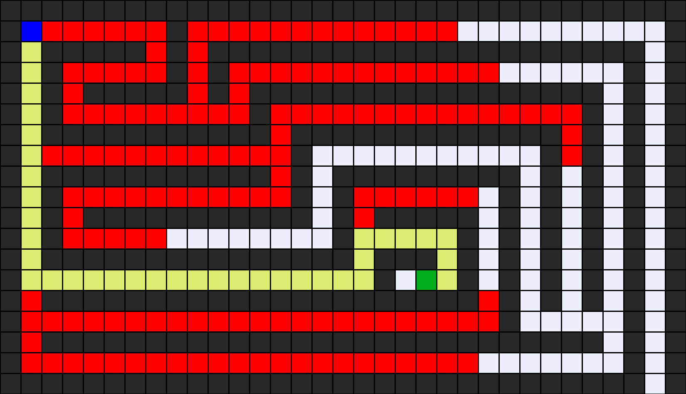

# Artificial Intelligence (AI) Learning Journey 🚀

Welcome to my AI repository! This repository contains my implementations and practice code as I learn Artificial Intelligence concepts, starting with search algorithms from **CS50’s Introduction to Artificial Intelligence with Python**.

---

## 🖼️ Maze Solution Visualization

Below is an example of how the search algorithm finds a path from the start point to the goal:



---

## 📂 Folder Structure: `bfs and dfs/`

This folder contains a Python-based **Maze Solver** that uses uninformed search algorithms to find a path from a start position ($A$) to a goal position ($B$).

* `maze.py`: Contains the core classes (`Node`, `StackFrontier`, `QueueFrontier`, and `Maze`) and search logic.
* `runner.py`: The execution script used to load a maze file, solve it, print states explored, and generate visual outputs.
* `small_maze.txt` & `big_maze.txt`: Sample maze text layout files.
* `output.png`: Generated image showing the solution path and explored states.

---
## 🛠️ How to Run the Code

1. **Prerequisites**: Make sure Python is installed on your system along with the `Pillow` library for image generation:
   ```bash
   pip install Pillow